<p align="center">
  
</p>

<p align="center">
  <a href="https://www.linkedin.com/in/monssif-el-haouari/"></a>
  <a href="https://tryhackme.com/p/Wirvxy"></a>
  <a href="https://github.com/Wirvxy/soc-journey"></a>
  
</p>

<p align="center">
  
</p>

## 🗂️ Case files

```yaml
case_2026_04:
  org: CHU Hassan II · Fès
  role: Network Security Intern
  mission: Deploy an IDS/IPS across the hospital network infrastructure
  status: DEPLOYED

case_2025_07:
  org: INTELCIA · Meknès
  role: IT Support & Helpdesk Intern
  mission: Workstation deployment & cloning, Active Directory integration, JIRA incident management
  status: CLOSED
```

## 🛰️ Operations

<table>
  <tr>
    <td width="50%" valign="top">
      <h3>🛰️ <a href="https://github.com/Wirvxy/crew-health-compass">Crew Health Compass</a></h3>
      <sub><b>NASA Space Apps 2026</b> · team of 4 · 48h</sub>
      <p>Offline-first health monitoring for astronauts on deep-space missions.</p>
      <p><b>🔐 My part: backend security</b></p>
      <ul>
        <li>FastAPI trust boundary: every input validated</li>
        <li>Server-side sessions, HttpOnly + SameSite cookies</li>
        <li>SHA-256 hash-chained audit log</li>
        <li>CI: pip-audit, npm audit, gitleaks, 200+ tests</li>
      </ul>
      
      
      
    </td>
    <td width="50%" valign="top">
      <h3>📷 <a href="https://github.com/Wirvxy/Brokenlens">Brokenlens</a></h3>
      <sub><b>Solo project</b> · open source (MIT)</sub>
      <p>Free camera PWA for iPhones with a broken main lens: it skips the damaged camera and uses the working ones directly.</p>
      <br/>
      <h3>🗑️ <a href="https://github.com/Wirvxy/smartbin-iot">SmartBin</a></h3>
      <sub><b>EST Fès</b> · team project</sub>
      <p>IoT smart-waste platform: LoRa sensors → AWS IoT → real-time dashboard + mobile app. Security-reviewed.</p>
      
      
      
      
    </td>
  </tr>
</table>

## 🧰 Arsenal

<p align="center">
  
</p>

<p align="center">
  <b>Blue Team stack (in training)</b><br/><br/>
  
  
  
  
  
  
</p>

<details>
<summary><b>🛡️ Open the SOC playbook I'm building</b></summary>
<br/>

| Phase | Skills | Where I train |
|---|---|---|
| 🔎 **Detect** | SIEM queries, alert triage, IDS/IPS rules | TryHackMe SOC L1 · Splunk · Elastic |
| 🧬 **Investigate** | Log analysis, network traffic (pcap), phishing analysis, MITRE ATT&CK mapping | Wireshark · CyberDefenders |
| 🚨 **Respond** | Incident reports, containment, documentation | SOC L1 case work · write-ups in [soc-journey](https://github.com/Wirvxy/soc-journey) |

</details>

## 📡 Mission status

| Track | Platform | Status |
|---|---|---|
| SOC Level 1 | TryHackMe |  |
| Advent of Cyber 2026 | TryHackMe |  |
| Ingénieur d'État · IT Security & Digital Trust | ENSIASD |  |

## 🐍 Contribution hunt

<picture>
  <source media="(prefers-color-scheme: dark)" srcset="https://raw.githubusercontent.com/Wirvxy/Wirvxy/output/snake-dark.svg"/>
  <source media="(prefers-color-scheme: light)" srcset="https://raw.githubusercontent.com/Wirvxy/Wirvxy/output/snake.svg"/>
  
</picture>

<p align="center">
  
</p>
